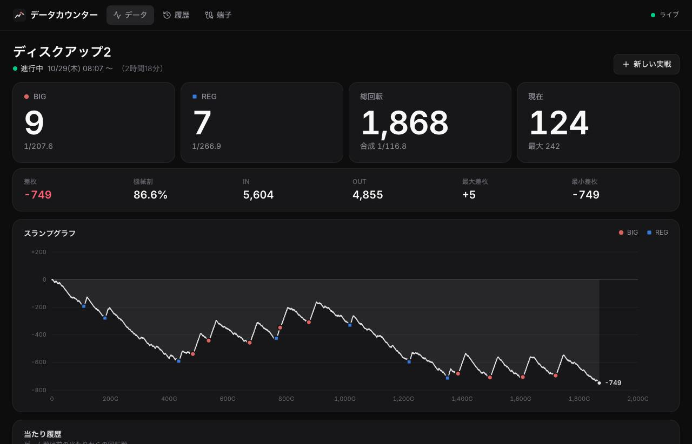

# データカウンター（家スロ用）

家庭用パチスロ実機の外部集中端子板から信号を取り込み、ブラウザで見られるデータカウンターを作るプロジェクトです。

- 記録の手入力はしません。メダルの投入・払い出し、ボーナスの信号をすべて自動で取り込みます
- ホールのデータカウンターの再現だけでなく、**端子の生の変化をすべて保存**して、あとから自由に集計し直せるようにしています



## できること

- 現在の実戦のデータ：BIG / REG などの回数と確率、総回転、現在のゲーム数、差枚、機械割、最大差枚・最大ハマり
- スランプグラフ（当たった位置に種別ごとの印）
- 当たり履歴と「答え合わせ」：当たりの前後の端子の ON / OFF をタイミングチャートと一覧で見られる
- 履歴：実戦ごとの記録。機種を付け替えると、生のイベントから数え直す
- 端子：Pico の接続状態と、届いた生のイベント・パルス幅（配線の確認用）

画面はリアルタイムに更新されます（メダルを入れると数字が動きます）。

## しくみ

```
外部集中端子板 CN2 ──(リレー接点)── Raspberry Pi Pico WH（firmware/）
                                        │  端子の変化を時刻付きで送る（HTTP POST、Wi-Fi）
                                        ▼
                               Raspberry Pi（apps/server/）
                                 ├─ SQLite に生イベントをすべて保存
                                 ├─ 集計（packages/core/ の集計エンジン）
                                 └─ API・画面の配信、Server-Sent Events でリアルタイム配信
                                        │
                                        ▼
                         PC / タブレットのブラウザ（apps/web/）
```

- **Pico は数えない**：各ピンの立ち下がり・立ち上がりを、起動からのマイクロ秒付きでそのまま送ります。数えたり判定したりするのはサーバーと画面の仕事なので、信号の解釈はあとから変えられます
- **取りこぼさない**：イベントには連番（seq）を振り、サーバーが受け取りを返すまで Pico が持っておきます。Wi-Fi が切れても、つながり直したときにまとめて送ります
- **チャタリング対策はサーバー側**：同じレベルが `debounceMs` 続いたときだけ変化として確定させます（機種ごとに設定）

## ディレクトリ

| 場所             | 中身                                                                                    |
| ---------------- | --------------------------------------------------------------------------------------- |
| `firmware/`      | Pico WH 用の MicroPython プログラム                                                     |
| `apps/server/`   | ラズパイで動くサーバー（Node.js、[Hono](https://hono.dev/)、`node:sqlite`）             |
| `apps/web/`      | 画面（[TanStack Start](https://tanstack.com/start) の SPA モード、React、Tailwind CSS） |
| `packages/core/` | サーバーと画面で共有する型、機種設定のスキーマ、集計エンジン                            |
| `machines/`      | 機種ごとの設定（どのピンが何の信号か）                                                  |
| `deploy/`        | ラズパイへのデプロイスクリプトと systemd のユニット                                     |

## 開発

言語のバージョンは [asdf](https://asdf-vm.com/) で管理しています（`.tool-versions`）。

```sh
asdf install          # Node.js / pnpm / Python
pnpm install
pnpm dev              # サーバー（:3012）と画面（:5173）を起動
```

実機がなくても、疑似的な Pico でデータを流せます。

```sh
pnpm simulate --history 2000   # 2000 ゲーム分を過去のデータとして入れてから、実時間で回し続ける
```

<http://localhost:5173> を開くと画面が見られます。ラズパイのデータを見ながら画面を触るときは `API_TARGET=http://<ラズパイ>:3012 pnpm --filter @data-counter/web dev`。

| コマンド         | 内容                                                      |
| ---------------- | --------------------------------------------------------- |
| `pnpm check`     | フォーマット・リント・型チェック・テストをまとめて実行    |
| `pnpm fmt`       | [oxfmt](https://oxc.rs/docs/guide/usage/formatter) で整形 |
| `pnpm lint`      | [oxlint](https://oxc.rs/docs/guide/usage/linter) でリント |
| `pnpm test`      | Vitest と、ファームウェアの unittest                      |
| `pnpm build`     | 画面とサーバーをビルド                                    |
| `pnpm deploy:pi` | ラズパイにデプロイ                                        |

## Pico の準備

[firmware/README.md](firmware/README.md) を見てください。

## ラズパイへのデプロイ

### ラズパイの準備（最初の 1 回）

Node.js は asdf で入れます（デプロイのときに `.tool-versions` の版が自動で入ります）。asdf 本体を入れておいてください。

```sh
# ラズパイで（arm64 の場合）
mkdir -p ~/.local/bin
curl -fsSL https://github.com/asdf-vm/asdf/releases/download/v0.20.2/asdf-v0.20.2-linux-arm64.tar.gz | tar xz -C ~/.local/bin
```

サーバーの設定を置きます。`INGEST_TOKEN` は Pico の `config.py` にも同じ値を書きます。

```sh
# ラズパイで
mkdir -p ~/data-counter
cat > ~/data-counter/.env <<EOF
PORT=3012
INGEST_TOKEN=$(openssl rand -hex 24)
DEFAULT_MACHINE=discup2
EOF
```

### デプロイ

```sh
cp deploy/.env.example deploy/.env   # DEPLOY_HOST=user@host を書く
pnpm deploy:pi
```

ビルドしたものだけを送るので、ラズパイ側で `pnpm install` は要りません。`data-counter` という systemd のサービスとして動きます。

```sh
journalctl -u data-counter -f        # ログ
sudo systemctl restart data-counter  # 再起動
```

### データベースを SSD に置く

ラズパイの `~/data-counter/.env` に `DATA_DIR` を書いてから `pnpm deploy:pi` します。サービスはそのフォルダにだけ書き込めるようになり、ディスクがマウントされるまで起動を待ちます。

```sh
# ラズパイで（/mnt/ssd は SSD のマウント先）
echo 'DATA_DIR=/mnt/ssd/data-counter' >> ~/data-counter/.env
```

使い始めたあとで移すときは、先にサービスを止めて（`sudo systemctl stop data-counter`）、`data-counter.db` をそのフォルダにコピーしてからデプロイします。

## 設定

### サーバー（`apps/server/.env`、ラズパイでは `~/data-counter/.env`）

| 変数              | 既定値                  | 内容                                                        |
| ----------------- | ----------------------- | ----------------------------------------------------------- |
| `HOST`            | `0.0.0.0`               | 待ち受けるアドレス。Pico から届くよう LAN に開けておく      |
| `PORT`            | `3012`                  | ポート                                                      |
| `INGEST_TOKEN`    | なし                    | Pico からの送信に求める Bearer トークン。設定を強くおすすめ |
| `DEFAULT_MACHINE` | `discup2`               | 実戦を自動で始めるとき、前の実戦がなければこの機種にする    |
| `DATA_DIR`        | `data/`                 | SQLite のデータベースの置き場所                             |
| `MACHINES_DIR`    | `machines/`             | 機種設定の置き場所                                          |
| `WEB_DIR`         | `apps/web/dist/client/` | 画面のビルド結果                                            |

### 機種（`machines/*.json`）

どのピンが何の信号かを機種ごとに書きます。エディタで補完が効くよう、`machine.schema.json` を参照しています。

```jsonc
{
  "$schema": "./machine.schema.json",
  "id": "discup2", // ファイル名と同じにする
  "name": "ディスクアップ2",
  "debounceMs": 10, // これより短い変化はチャタリングとして捨てる（50 未満にする）
  "gameGapMs": 1000, // IN のパルスがこれだけあいたら次のゲーム
  "pins": { "in": 1, "out": 2 },
  "signals": [
    { "pin": 4, "kinds": [{ "id": "big", "label": "BIG", "color": "red" }] },
    { "pin": 3, "kinds": [{ "id": "reg", "label": "REG", "color": "blue" }] },
  ],
}
```

- ゲーム数は、レバーオンで出る IN のパルスの塊を 1 ゲームとして数えます。IN 枚数の割り算ではないので、ボーナス中などでベット枚数が変わっても数えられます
- `debounceMs` を 50 以上にすると IN / OUT のパルスまで捨ててしまうので、設定の読み込みで止めます（目安は 10）
- 信号が ON になった瞬間を当たりとして数えます。ON の間の払い出し枚数とゲーム数も記録します
- 1 つのピンから複数の種別が出る機種（エウレカの BIG と REG など）は、`kinds` を並べて `maxOut` を書くと、ON の間の払い出し枚数で種別を分けます
- `resetsGames: false` にすると、その信号では現在のゲーム数（ハマり）を 0 に戻しません
- スキーマを変えたら `pnpm --filter @data-counter/core generate:schema` で `machine.schema.json` を作り直します

数え方を変えても、生のイベントは残っているので、過去の実戦もその設定で数え直されます。

## Pico からサーバーへの送信

`POST /api/ingest`（`Authorization: Bearer <INGEST_TOKEN>`）

```json
{
  "device": "pico-datacounter",
  "boot": "9f3a1c2e",
  "now": 123456789,
  "events": [
    [1, 1, 0, 123400000],
    [2, 1, 1, 123435000]
  ],
  "remaining": 0,
  "status": {
    "rssi": -55,
    "memFree": 150000,
    "dropped": 0,
    "levels": [
      [1, 1],
      [2, 1]
    ]
  }
}
```

- `boot`：起動のたびに作る乱数。`seq` と組み合わせてイベントを一意にする
- `now`：送信した時点の、Pico の起動からのマイクロ秒。サーバーは最初に届いたときの受信時刻との差で実時刻に直す
- `events`：`[seq, CN2 のピン番号, レベル（0 = 接点が閉じた）, 起動からのマイクロ秒]`
- `remaining`：送りきれずに Pico に残っている件数
- 返事は `{ "ack": 2 }`。Pico はこれ以下の seq を捨てる

## API

| メソッド | パス                    | 内容                                                 |
| -------- | ----------------------- | ---------------------------------------------------- |
| GET      | `/api/sessions/current` | 進行中の実戦と集計結果                               |
| GET      | `/api/sessions`         | 実戦の一覧（新しい順）                               |
| GET      | `/api/sessions/:id`     | 実戦 1 回分の集計結果                                |
| POST     | `/api/sessions`         | 新しい実戦を始める `{ machineId }`                   |
| PATCH    | `/api/sessions/:id`     | 実戦の機種を変える `{ machineId }`                   |
| GET      | `/api/events?from&to`   | 生イベント（UNIX エポックからの µs）                 |
| GET      | `/api/machines`         | 機種設定                                             |
| GET      | `/api/devices`          | Pico の状態                                          |
| GET      | `/api/stream`           | Server-Sent Events（`session` / `edges` / `device`） |

生のデータは SQLite（`data/data-counter.db`）の `events` テーブルにあるので、SQL で直接分析することもできます。

## まだ実機で確かめていないこと

- 外部出力（BIG / REG）が、当選時に 1 回だけパルスを出すのか、ボーナス中ずっと ON なのか
  - どちらでも回数は数えられます。ずっと ON なら、ボーナス中の払い出し枚数とゲーム数も出せます
  - エウレカの BIG / REG の判別は、ずっと ON のときだけ働きます
- IN / OUT のパルス幅と、1 ゲームのパルスの塊の間隔（`debounceMs` と `gameGapMs` が合っているか）。端子のページの「パルス幅」と「届いたイベント」で測れます
- リプレイのときに IN の信号が出るか（出ないと総回転が少なく数えられます）

## ライセンス

[MIT](LICENSE)
